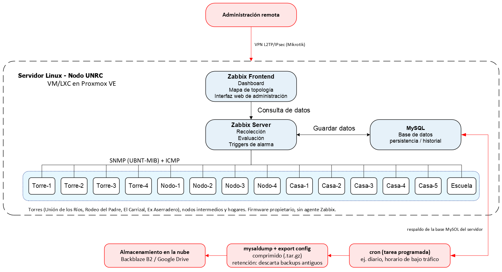

# Guía de implementación

**Versión 2.3** · Zabbix 7.0 LTS · Red Comunitaria y Científica Las Lagunitas (Alpa Corral, Córdoba)

Esta guía explica cómo instalar y poner en marcha el sistema de monitoreo en el **servidor de
producción** que supervisa la red real. La incorporación de cada equipo (radios, routers, access
points) se detalla en la [Guía de integración de equipos](guia-integracion-equipos.md) y la
operación diaria en el [Manual de administración](manual-administracion.md).

Toda la configuración de Zabbix se genera automáticamente desde el **inventario de la red**
(`config/inventory.produccion.yaml`) con la herramienta `bin/lagunitas`.

> **Alcance y estado.** El sistema se validó en el entorno de laboratorio, que reproduce la
> topología de la red con equipos simulados (ver la [Guía del laboratorio](laboratorio.md) y el
> informe de la PPS). El despliegue sobre la red física está pendiente. Por eso los datos propios
> del entorno real (direcciones IP, nombre de acceso, comunidad SNMP, destino de los respaldos)
> figuran en esta guía como parámetros entre `< >` y deben definirse al momento de la instalación.

Parámetros que se usan a lo largo de la guía:

| Parámetro | Significado |
|---|---|
| `<ZBX_DOMAIN>` | Nombre DNS o dirección IP con que los operadores acceden al frontend |
| `<IP_SERVIDOR>` | Dirección IP del servidor de monitoreo en la red de gestión |
| `<IP_EQUIPO>` | Dirección IP de gestión de un equipo de la red |
| `<IP_CONTROLADOR>`, `<PUERTO>` | Dirección y puerto HTTPS del controlador UniFi Network |
| `<REMOTO>` | Nombre del destino configurado en rclone para la copia externa de los respaldos |

---

## Arquitectura



Componentes del servidor de monitoreo:

```
                         ┌──────────────── Servidor de monitoreo ────────────────┐
  Operadores ── HTTPS ──▶│ Caddy ──▶ zabbix-web (frontend + módulos Lagunitas)    │
  (navegador)            │                     │                                   │
                         │               zabbix-server ──▶ MySQL                   │
                         │                 │   │   └── zabbix-agent (auto-monitoreo)│
                         └─────────────────┼───┼───────────────────────────────────┘
                              ICMP (fping)│   │SNMP v2c / HTTPS API
                                          ▼   ▼
             Mikrotik (gateway) ── torres ── nodos ── hogares / escuela  (red WISP)
```

| Componente | Descripción |
|---|---|
| Servidor | Linux (Ubuntu Server LTS) en una VM o contenedor LXC de Proxmox VE en el nodo UNRC, con alimentación estable |
| Administración remota | VPN L2TP/IPsec terminada en el Mikrotik de la red |
| Respaldo | Backup diario comprimido (base + configuración) copiado a almacenamiento en la nube (Backblaze B2 / Google Drive) |
| Stack | `deploy/produccion/docker-compose.yml`: MySQL 8.0, Zabbix server 7.0.30, frontend, agente y Caddy 2.8 (HTTPS) |
| Acceso web | `https://<ZBX_DOMAIN>` |
| Equipos | Equipos reales de la red, alcanzados por ruteo o VPN desde el servidor |
| Configuración | `config/inventory.produccion.yaml` + `bin/lagunitas aprovisionar` |

Los cinco servicios del stack y su función:

| Servicio | Imagen | Función | Puertos publicados en el servidor |
|---|---|---|---|
| `mysql-server` | `mysql:8.0` | Base de datos (configuración e historial), en el volumen `mysql_data` | Ninguno |
| `zabbix-server` | `zabbix/zabbix-server-mysql:ubuntu-7.0.30` | Recolección (ICMP, SNMP, HTTP), evaluación de triggers y envío de alertas | 10051/TCP |
| `zabbix-web` | `zabbix/zabbix-web-apache-mysql:ubuntu-7.0.30` | Frontend y módulos propios (`zabbix/modules/`, montados en solo lectura) | Ninguno (solo a través de Caddy) |
| `zabbix-agent` | `zabbix/zabbix-agent2:ubuntu-7.0.30` | Auto-monitoreo del servidor (host *Zabbix server*) | Ninguno |
| `caddy` | `caddy:2.8` | Proxy inverso HTTPS delante del frontend | 80/TCP y 443/TCP |

**Métodos de recolección**

- **ICMP** (template *Lagunitas - Disponibilidad ICMP*): el Zabbix server hace ping a cada
  equipo cada 10 s (macro global `{$LAGUNITAS.INTERVALO}`, que también rige SNMP y la API de
  UniFi). Funciona con cualquier equipo con IP, incluidos los routers airCube de los hogares, que
  no tienen SNMP ni API documentada.
- **SNMP v2c** (templates *Lagunitas - Ubiquiti airMAX por SNMP* y *Lagunitas - Mikrotik por
  SNMP*): radios airMAX (PowerBeam, LiteBeam, NanoStation, NanoLoco) y el router Mikrotik. Aportan
  señal, ruido, SNR, CCQ, capacidad airMAX, estaciones asociadas, interfaces, voltaje de batería,
  clientes DHCP, estado del enlace a Internet, CPU y memoria.
- **API REST de UniFi** (template *Lagunitas - AP UniFi por API*): access points UniFi
  administrados por UniFi Network.

**Topología y dependencias.** Cada equipo declara en el inventario su *padre* (el equipo del que
depende su conectividad). El provisionador convierte esa relación en **dependencias entre
triggers**: si cae una torre, Zabbix alerta solo por la torre y suprime las alertas de todos los
nodos y hogares aguas abajo. El widget los muestra como **"Sin servicio"** y el reporte los
contabiliza en la *disponibilidad del servicio*. Para que el padre se detecte siempre primero,
cada nivel de la topología espera 15 s más que el anterior antes de declarar la caída (90 s el
gateway, 105 s el primer nivel, 120 s el segundo, y así sucesivamente).

---

## Requisitos

### Servidor

| Recurso | Mínimo | Recomendado |
|---|---|---|
| CPU | 2 vCPU | 4 vCPU |
| RAM | 4 GB | 8 GB |
| Disco | 40 GB SSD | 80 GB SSD (historial 90 días, tendencias 1 año) |
| SO | Ubuntu Server 22.04/24.04 LTS (VM o LXC en Proxmox VE) | |
| Energía | Con UPS | UPS + arranque automático de servicios |

Software: Docker Engine 24+ con el plugin Compose v2, Git y Python 3.10+ (`python3-venv`).

Consideraciones de dimensionamiento:

- Los valores de la tabla son una estimación de diseño para los 32 equipos del inventario con
  mediciones cada 10 s. Conviene revisar el uso real de disco durante las primeras semanas
  (`docker system df -v` y `df -h`).
- El historial de cada ítem se conserva 90 días y las tendencias horarias 365 días (valores
  definidos en los templates). Si el disco resulta escaso, se puede reducir el historial con la
  clave `retencion_historial` del inventario (ver *Completar el inventario*) o subir el intervalo
  de medición.
- MySQL usa por defecto 1 GB de *buffer pool* (`MYSQL_INNODB_BUFFER`). Con 8 GB de RAM se puede
  subir a 2 GB.
- Si se usa un contenedor LXC, debe tener habilitada la opción *nesting* para poder ejecutar
  Docker. Una VM evita esa dependencia y es la opción más simple.

### Red

Flujos que deben estar permitidos (firewall del Mikrotik, de la VPN y del propio servidor):

| Origen | Destino | Protocolo y puerto | Uso |
|---|---|---|---|
| Servidor | Todos los equipos de la red | ICMP (echo request / echo reply) | Disponibilidad, latencia y pérdida |
| Servidor | Radios airMAX y Mikrotik | UDP/161 (SNMP v2c) | Métricas de radio, energía e interfaces |
| Servidor | Controlador UniFi | TCP/443 u otro puerto HTTPS (macro `{$UNIFI.PORT}`) | API de UniFi Network |
| Operadores (LAN o VPN) | Servidor | TCP/443 (TCP/80 solo redirige a HTTPS) | Frontend |
| Administrador (VPN) | Servidor | TCP/22 | Administración por SSH |
| Servidor | Internet | TCP/443, UDP/53 (DNS), UDP/123 (NTP) | Alertas a `api.telegram.org`, imágenes Docker, GitHub, PyPI, copia de respaldos |
| Internet | Servidor | TCP/80 y TCP/443 | Solo si se usa un certificado de Let's Encrypt (dominio público) |
| Zabbix proxy | Servidor | TCP/10051 | Solo si se usa un proxy remoto (ver *Zabbix proxy en Las Lagunitas*) |

- Las consultas salen de los contenedores con NAT de Docker, por lo que los equipos ven como
  origen la `<IP_SERVIDOR>`. Esa es la dirección que hay que autorizar en los equipos y en el
  firewall.
- `<ZBX_DOMAIN>` debe resolver a la `<IP_SERVIDOR>` tanto en las computadoras de los operadores
  como en el propio servidor, porque el provisionador accede a la API por ese nombre. Si no hay
  DNS, alcanza con una entrada estática en el DNS del Mikrotik o en el archivo `/etc/hosts`.
- El servidor necesita la hora sincronizada (NTP), ya que las marcas de tiempo de los datos, las
  ventanas de los triggers y el SLA dependen de ella.
- La VPN L2TP/IPsec de administración ya existe en el Mikrotik de la red y no forma parte de esta
  instalación.

---

## Instalación

Orden de los pasos: preparar el servidor, obtener el proyecto y configurar los secretos, levantar
el stack, hacer el primer acceso, preparar los equipos, completar el inventario, aprovisionar y
verificar. Las notificaciones, los respaldos y el resto de las secciones se configuran después.
Cada paso termina con una verificación, y conviene no avanzar si esa verificación falla.

### Preparar el servidor

```bash
sudo apt update && sudo apt install -y ca-certificates curl git python3-venv
curl -fsSL https://get.docker.com | sudo sh
sudo usermod -aG docker $USER        # cerrar sesión y volver a entrar
sudo systemctl enable docker
sudo timedatectl set-timezone America/Argentina/Cordoba
sudo ufw allow OpenSSH && sudo ufw allow 443/tcp && sudo ufw allow 80/tcp && sudo ufw enable
```

Verificación:

```bash
docker --version && docker compose version    # Docker 24 o superior, Compose v2
docker run --rm hello-world                   # Docker funciona sin sudo
timedatectl                                   # zona horaria correcta y "System clock synchronized: yes"
ping -c 3 <IP_EQUIPO>                         # el servidor alcanza la red de gestión
```

> **Docker y ufw.** Los puertos que publica Docker (80, 443 y 10051) se abren con reglas propias
> de iptables que no pasan por las reglas de `ufw`. El puerto 10051/TCP del Zabbix server queda
> entonces accesible desde cualquier red que llegue al servidor, aunque `ufw` no lo permita. Si
> no se usan proxies ni agentes activos remotos, hay que filtrarlo en el firewall perimetral (el
> Mikrotik o el firewall de la VM en Proxmox) o con una regla en la cadena `DOCKER-USER`.

### Obtener el proyecto y configurar secretos

```bash
sudo mkdir -p /opt/zabbix-lagunitas && sudo chown $USER /opt/zabbix-lagunitas
git clone https://github.com/ecoranti/zabbix-lagunitas.git /opt/zabbix-lagunitas
cd /opt/zabbix-lagunitas
cp deploy/produccion/.env.example deploy/produccion/.env
cp .env.example .env
chmod 600 .env deploy/produccion/.env
```

Hay dos archivos de secretos, y ninguno se versiona.

`deploy/produccion/.env` lo lee Docker Compose para el stack:

| Variable | Valor |
|---|---|
| `MYSQL_DATABASE`, `MYSQL_USER` | `zabbix` (valores por defecto) |
| `MYSQL_PASSWORD`, `MYSQL_ROOT_PASSWORD` | Contraseñas propias, generadas con `openssl rand -base64 24` |
| `MYSQL_INNODB_BUFFER` | Memoria del *buffer pool* de MySQL (por defecto `1G`) |
| `ZBX_SERVER_NAME` | Nombre que muestra el frontend (`Red Las Lagunitas`) |
| `PHP_TZ` | Zona horaria del frontend (`America/Argentina/Cordoba`) |
| `ZBX_DOMAIN` | `<ZBX_DOMAIN>`: nombre o IP con que se accederá al frontend |
| `CADDY_TLS` | `internal` para un certificado propio (LAN o VPN), o una dirección de email para obtener un certificado de Let's Encrypt si hay un dominio público |

Las contraseñas de MySQL se aplican solo cuando se crea la base por primera vez. Cambiarlas
después en el archivo no modifica las que ya están guardadas en el volumen.

`.env` (en la raíz del proyecto) lo lee `bin/lagunitas`:

| Variable | Valor en producción |
|---|---|
| `ZABBIX_URL` | `https://<ZBX_DOMAIN>/api_jsonrpc.php` |
| `ZABBIX_API_TOKEN` | Token del usuario de servicio (se crea en *Primer acceso y endurecimiento*) |
| `ZABBIX_USER`, `ZABBIX_PASSWORD` | Vacías cuando se usa el token |
| `ZABBIX_VERIFY_TLS` | `false` con `CADDY_TLS=internal` (certificado propio); `true` con Let's Encrypt |
| `LAGUNITAS_INVENTORY` | `config/inventory.produccion.yaml` |
| `PHP_TZ` | Zona horaria con que se calcula el SLA (`America/Argentina/Cordoba`) |
| `SNMP_COMMUNITY` | Comunidad SNMP v2c de los equipos (no usar `public`) |
| `UNIFI_API_KEY` | API key de UniFi Network, solo si hay APs UniFi |
| `TELEGRAM_BOT_TOKEN`, `TELEGRAM_CHAT_ID` | Notificaciones (ver *Notificaciones por Telegram*) |

Las variables `MYSQL_*`, `ZBX_SERVER_NAME` y `ZABBIX_WEB_PORT` de este segundo archivo solo las
usa el stack del laboratorio y en producción no tienen efecto.

Verificación:

```bash
ls -l .env deploy/produccion/.env             # permisos -rw------- en ambos
cd deploy/produccion && docker compose config --quiet && echo "compose válido"
```

### Levantar el stack

```bash
cd /opt/zabbix-lagunitas/deploy/produccion
docker compose up -d
docker compose ps          # los 5 servicios en ejecución; mysql-server y zabbix-web "healthy"
```

La primera vez MySQL tarda 1–2 minutos en crear el esquema.

Verificación:

```bash
docker compose logs --tail 20 zabbix-server   # sin errores de conexión a la base
curl -sk -H 'Content-Type: application/json-rpc' \
  -d '{"jsonrpc":"2.0","method":"apiinfo.version","params":{},"id":1}' \
  https://<ZBX_DOMAIN>/api_jsonrpc.php        # responde {"jsonrpc":"2.0","result":"7.0.30","id":1}
```

Con `CADDY_TLS=internal` el navegador muestra una advertencia de certificado, porque lo firma la
autoridad certificante interna de Caddy. Es el comportamiento esperado. Para evitar la
advertencia se puede instalar el certificado raíz de Caddy en las computadoras de los operadores
(se guarda en el volumen `caddy_data`, en `/data/caddy/pki/authorities/local/root.crt`).

### Primer acceso y endurecimiento

1. Entrar a `https://<ZBX_DOMAIN>` con el usuario `Admin` y la contraseña por defecto de Zabbix
   (`zabbix`) y **cambiarla de inmediato** (*User settings → Profile → Change password*). No
   renombrar el usuario `Admin`, porque el provisionador lo busca por ese nombre para asignarle
   el grupo de operadores y el medio Telegram.
2. Crear un usuario de servicio para el provisionador (*Users → Users → Create user*), rol
   *Super admin role*, y generarle un **API token** (*Users → API tokens*). Guardarlo en `.env`
   como `ZABBIX_API_TOKEN` y dejar vacíos `ZABBIX_USER` y `ZABBIX_PASSWORD`.
3. *Administration → General → GUI*: zona horaria por defecto `America/Argentina/Cordoba`.

Verificación: `bin/lagunitas validar` debe mostrar el resumen del inventario. La primera
ejecución de `bin/lagunitas` crea el entorno Python (`.venv`) e instala las dependencias, por lo
que necesita salida a Internet. La conexión con la API se comprueba recién al aprovisionar.

### Preparar los equipos de la red

Cada equipo debe responder ping desde el servidor y, según su tipo, tener SNMP habilitado o una
API key creada. El paso a paso por tipo de equipo (radios airMAX, Mikrotik, airCube, UniFi) está
en la [Guía de integración de equipos](guia-integracion-equipos.md). Antes de cargar cada equipo,
comprobarlo desde el servidor:

```bash
cd /opt/zabbix-lagunitas
(cd deploy/produccion && docker compose exec zabbix-server fping -c3 <IP_EQUIPO>)   # ping desde Zabbix
bin/lagunitas probar-snmp <IP_EQUIPO>                 # radios airMAX y Mikrotik
bin/lagunitas unifi-ids <IP_CONTROLADOR> <PUERTO>     # APs UniFi (puerto 443 si se omite)
```

`probar-snmp` y `unifi-ids` se ejecutan dentro de la red del contenedor `zabbix-server`, es
decir, con la misma conectividad que tendrá Zabbix. Por eso requieren que el stack esté
levantado. `probar-snmp` usa la comunidad de `SNMP_COMMUNITY` (o la indicada con `--comunidad`) e
informa los perfiles que corresponde cargar en el inventario.

### Completar el inventario

`config/inventory.produccion.yaml` contiene la topología relevada en campo (gateway, 4 torres,
9 nodos y 13 hogares e instituciones, más los equipos secundarios de cada sitio). Las direcciones
`192.168.88.x` que trae el archivo son provisorias (rango por defecto del Mikrotik) y están
marcadas con `COMPLETAR`. Para cada elemento completar:

| Campo | Qué poner |
|---|---|
| `host` | Nombre técnico en Zabbix, sin espacios y único. Es la clave del equipo y no debe cambiarse. |
| `nombre` | Nombre visible. |
| `rol` | `gateway`, `torre`, `nodo`, `hogar`, `institucion` o `ap`. |
| `ip` | IP de gestión real del equipo (reemplazar las marcadas `COMPLETAR`). No puede repetirse. |
| `estado` | `operativo` si el tramo está en servicio; `en_proceso` o `sin_configurar` si no (el host se crea deshabilitado y se ve en gris en el mapa). |
| `perfiles` | `[icmp]` para todos; agregar `airos_snmp` en radios airMAX con SNMP habilitado, `mikrotik_snmp` en el Mikrotik y `unifi_api` en los APs UniFi. |
| `funcion` | `ap`, `sm`, `ptp`, `router`, `switch` u `otro`. |
| `modelo` | Modelo exacto (se guarda en el inventario de Zabbix). |
| `padre` | Equipo del que depende (define dependencias de alertas y el camino en el mapa). Debe existir en el inventario y no formar ciclos. |
| `dispositivos` | Los demás equipos con IP del sitio (AP que retransmite, router del hogar), cada uno con su host, IP, función, modelo y perfiles. |
| `equipo` | Descripción del hardware del sitio (se guarda en el inventario de Zabbix). |
| `mapa` | Posición `[x, y]` del sitio en el mapa de topología. |
| `macros` | (opcional) Umbrales propios del equipo, por ejemplo para enlaces largos, y los datos del controlador en los APs UniFi. |

Clave opcional de nivel superior:

| Clave | Efecto |
|---|---|
| `retencion_historial` | Período de historial que se conserva en toda la instalación (por ejemplo `30d`). Si está definida, el aprovisionamiento activa en *Administration → Housekeeping* la opción que reemplaza el período de historial de los ítems por ese valor. Las tendencias no cambian. El inventario de producción no la define, por lo que rigen los 90 días de los templates. Quitar la clave no revierte el cambio: hay que desactivar la opción en *Housekeeping*. |

Validar el archivo sin tocar Zabbix:

```bash
bin/lagunitas validar
```

Con el inventario tal como está versionado, la salida es la siguiente. Si hay errores (IP
repetida, padre inexistente, perfil desconocido, YAML mal formado), el comando los enumera y
termina sin conectarse a Zabbix.

```
Inventario 'produccion' válido: 27 sitios, 32 equipos (5 dispositivos secundarios)
  funciones: router=5, ap=3, sm=7, otro=17
  roles:    gateway=1, torre=4, nodo=10, hogar=14, institucion=3
  estados:  operativo=20, en_proceso=4, sin_configurar=8
  perfiles: icmp=32, mikrotik_snmp=1, airos_snmp=10
  equipos sin padre (raíces): Gateway_Mikrotik
```

### Aprovisionar

```bash
bin/lagunitas aprovisionar
```

Pasos que ejecuta, en este orden (se pueden correr por separado con `--solo <paso>`):

| Paso | Qué crea/actualiza |
|---|---|
| `templates` | Templates propios (ICMP, airMAX por SNMP, Mikrotik por SNMP, UniFi por API), valuemaps, triggers, descubrimientos y dashboards de detalle |
| `hosts` | Grupos por rol, hosts, interfaces, tags, inventario y macros (secretas) |
| `dependencias` | Dependencias padre → hijo de los triggers de caída; las alertas "sin datos SNMP/API" dependen de la caída del propio equipo |
| `servidor` | Auto-monitoreo del Zabbix server vía el contenedor `zabbix-agent`, refresco de 10 s del frontend para todos los usuarios y retención del historial si el inventario define `retencion_historial` |
| `mapa` | Mapa *Las Lagunitas - Topología* con leyenda y enlaces por estado |
| `servicios` | Árbol de servicios y SLA mensual (objetivo 99,5 %) |
| `modulos` | Registra y habilita los módulos del frontend (widget y reporte) |
| `dashboard` | Dashboard *Las Lagunitas - Centro de monitoreo* |
| `alertas` | Grupo de operadores, acción de notificación y Telegram (si está configurado) |

El proceso es **idempotente**: puede ejecutarse las veces que haga falta; actualiza lo existente
sin duplicar. Los cambios hechos a mano en Zabbix sobre estos objetos se pisan en el siguiente
aprovisionamiento: toda modificación permanente se hace en el inventario o en el código.

La primera vez hay que ejecutar el aprovisionamiento completo, porque los pasos dependen de
objetos creados por los anteriores (por ejemplo, `dashboard` necesita el mapa y el SLA). El
comando informa la versión de Zabbix y el inventario usado, muestra cada paso entre corchetes y
termina con `Listo.`. Los avisos del tipo `[aviso] <host>: SNMP_COMMUNITY no definida` indican
que falta un secreto en `.env`.

### Verificar

```bash
bin/lagunitas verificar
```

Compara los hosts de Zabbix con el inventario y lista los ítems no soportados, los problemas
abiertos y los templates del proyecto. Termina con código de salida distinto de cero si falta
algún host. En el frontend comprobar:

- [ ] *Dashboards → Las Lagunitas - Centro de monitoreo*: todos los equipos operativos
      "En línea" y los tramos no habilitados como "No monitoreado".
- [ ] Mapa de topología con enlaces verdes (operativos), discontinuos (en proceso) y punteados
      (sin configurar).
- [ ] En el detalle de cada radio y del Mikrotik aparecen sus pestañas específicas con datos.
- [ ] *Reports → Disponibilidad de la red* genera el reporte y el detalle técnico.
- [ ] *Services → SLA report* muestra el SLA *Las Lagunitas - Disponibilidad mensual*.
- [ ] Prueba de alarma controlada: desconectar (o bloquear el ping de) un equipo de borde y
      confirmar la alerta y su recuperación.

---

## Notificaciones por Telegram

Requiere salida HTTPS desde el servidor hacia `api.telegram.org`.

1. En Telegram, abrir **@BotFather**, enviar `/newbot`, elegir un nombre (por ejemplo *Monitoreo
   Las Lagunitas*) y un usuario terminado en `bot`. BotFather responde con el **token** del bot.
2. Guardar el token en `.env` como `TELEGRAM_BOT_TOKEN` (editando el archivo; el token es un
   secreto y no debe pegarse en chats ni commits).
3. Crear un grupo de Telegram para los operadores, **agregar el bot** y escribir cualquier mensaje
   en el grupo. Obtener el identificador del chat:

   ```bash
   bin/lagunitas telegram-chat-id
   ```

   Muestra una línea `TELEGRAM_CHAT_ID=...` por cada chat (los grupos tienen ID negativo). Copiarla
   en `.env`.
4. Configurar Zabbix y probar el envío:

   ```bash
   bin/lagunitas aprovisionar --solo alertas
   bin/lagunitas probar-telegram
   ```

   El aprovisionamiento habilita el media type *Telegram* con mensajes en español
   (🔴 problema, ✅ resuelto, 💬 actualización) y lo asigna al usuario `Admin` para severidades
   Warning, Average, High y Disaster. En Telegram, cada "Resuelto" aparece como respuesta al mensaje del
   problema.

Las notificaciones avisan al grupo *Operadores Las Lagunitas* los problemas de severidad
**Warning o mayor**, envían un recordatorio a los 30 minutos si siguen abiertos y avisan la
recuperación. Las alertas se notifican con dos acciones. *Las Lagunitas - Notificar caídas* atiende los
problemas de disponibilidad (triggers con la etiqueta `alcance=disponibilidad`: un equipo que no
responde al ping o un AP fuera de línea) y, cuando el equipo vuelve, avisa «volvió a estar en
línea» junto con los enlaces que se restablecen, es decir, los equipos monitoreados que dependen de
él según el inventario (macro `{$LAGUNITAS.RESTABLECE}`, que arma el provisionador).
*Las Lagunitas - Notificar degradación* atiende el resto (señal, interferencia, energía, recursos)
con el aviso de resuelto estándar. Los problemas suprimidos por un mantenimiento no se notifican.

### Seguridad del bot de Telegram

**Modelo:** el bot es de **solo envío**. Zabbix llama por HTTPS saliente a `api.telegram.org` con el
token para publicar las alertas; no hay webhook, ni puerto abierto en el servidor, ni ningún
programa que lea o ejecute lo que se le escriba al bot. Telegram no permite impedir que alguien le
escriba al bot, pero esos mensajes no tienen ningún efecto: no llegan a Zabbix ni al servidor
(Telegram los descarta a las 24 h). Por eso no es posible atacar Zabbix "a través del bot".

Lo que sí hay que proteger son dos cosas:

- **El token.** Quien lo tenga puede publicar mensajes como si fuera el bot (por ejemplo, alertas
  falsas en el grupo) y leer los mensajes que le hayan enviado. Vive solo en `.env` (permisos 600,
  fuera de git) y en el media type de Zabbix (visible únicamente para Super admin). No pegarlo en
  chats, capturas ni commits.
- **La cuenta de Telegram dueña del bot**, que es la que lo administra desde @BotFather.

Configuración recomendada (una sola vez, después de agregar el bot al grupo):

| Dónde | Qué hacer | Para qué |
|---|---|---|
| @BotFather → `/setjoingroups` → Disable | Nadie puede agregar el bot a otros grupos | Que no se use el bot fuera del grupo de operadores |
| @BotFather → `/setprivacy` → Enable (es el valor por defecto) | El bot no lee los mensajes del grupo | Que un token filtrado no exponga las conversaciones |
| @BotFather | No configurar comandos, modo inline ni webhook | Que no haya nada que procese mensajes entrantes |
| Grupo → Permisos | "Agregar miembros": solo administradores; el bot como miembro común (no administrador) | Controlar quién recibe las alertas |
| Grupo → Enlaces de invitación | Revocar los enlaces compartidos y usar invitaciones puntuales | Que no entren desconocidos |
| Telegram → Ajustes → Privacidad y seguridad | Activar la **verificación en dos pasos** en la cuenta dueña del bot | Que no se pueda tomar control del bot robando la cuenta |

Para comprobarlo en cualquier momento (envía un mensaje de prueba y revisa la configuración):

```bash
bin/lagunitas probar-telegram
```

Cada chequeo debe decir `OK`; los que dicen `REVISAR` indican qué corregir. Si el token se expuso
(se pegó en un chat, apareció en una captura, alguien reporta mensajes extraños del bot): en
@BotFather `/revoke` → elegir el bot → copiar el token nuevo en `TELEGRAM_BOT_TOKEN` de `.env` →
`bin/lagunitas aprovisionar --solo alertas` → `bin/lagunitas probar-telegram`. El token anterior
deja de funcionar en el acto.

---

## Backups

`scripts/backup.sh` genera dos archivos por ejecución y borra los que tienen más de 14 días
(variable `RETENCION_DIAS`):

| Archivo | Contenido |
|---|---|
| `zabbix_AAAAMMDD_HHMM.sql.gz` | Volcado completo de la base (`mysqldump --single-transaction`), con toda la configuración y el historial. El script comprueba que el volcado haya terminado y falla si está incompleto. |
| `config_AAAAMMDD_HHMM.tar.gz` | Templates y mapa exportados en YAML (`zabbix/export/`) y los inventarios (`config/`). |

Preparar el destino y ejecutar un primer respaldo a mano:

```bash
sudo mkdir -p /var/backups/zabbix && sudo chown $USER /var/backups/zabbix
sudo touch /var/log/zabbix-backup.log && sudo chown $USER /var/log/zabbix-backup.log
COMPOSE_DIR=/opt/zabbix-lagunitas/deploy/produccion /opt/zabbix-lagunitas/scripts/backup.sh /var/backups/zabbix
ls -lh /var/backups/zabbix
```

Programarlo diariamente con `crontab -e`, con el mismo usuario (que debe pertenecer al grupo
`docker`):

```
0 3 * * * COMPOSE_DIR=/opt/zabbix-lagunitas/deploy/produccion /opt/zabbix-lagunitas/scripts/backup.sh /var/backups/zabbix >> /var/log/zabbix-backup.log 2>&1
```

Copiar los respaldos **fuera del servidor**, por ejemplo con [rclone](https://rclone.org) hacia
Backblaze B2 o Google Drive (configurar el destino una vez con `rclone config`):

```
30 3 * * * rclone sync /var/backups/zabbix <REMOTO>:zabbix-lagunitas >> /var/log/zabbix-backup.log 2>&1
```

Aspectos a tener en cuenta:

- Los archivos `.env` **no** forman parte del respaldo. Guardar una copia de ambos en un gestor de
  contraseñas o en otro lugar seguro, porque sin ellos no se puede reconstruir el servidor.
- El volcado contiene las macros secretas de Zabbix (comunidad SNMP, API key de UniFi) y el token
  del bot. Conviene cifrar la copia externa (por ejemplo, con un remoto de tipo `crypt` de rclone)
  y limitar quién accede al almacenamiento.
- Revisar periódicamente `/var/log/zabbix-backup.log` y la fecha del último archivo.

### Restauración

`scripts/restore.sh` reemplaza **toda** la base (configuración e historial) con el contenido de un
volcado. Primero comprueba que el archivo sea un gzip íntegro con la marca final de `mysqldump` y
que la base esté en marcha; recién entonces pide escribir `RESTAURAR` para confirmar, detiene
`zabbix-server` y `zabbix-web`, importa el archivo y vuelve a iniciarlos, también si la
importación falla.

```bash
cd /opt/zabbix-lagunitas
COMPOSE_DIR=/opt/zabbix-lagunitas/deploy/produccion scripts/restore.sh /var/backups/zabbix/zabbix_AAAAMMDD_HHMM.sql.gz
bin/lagunitas verificar
```

Para reconstruir el sistema en un servidor nuevo:

1. Seguir *Preparar el servidor* y *Obtener el proyecto y configurar secretos*, recuperando los
   dos archivos `.env` desde su copia segura.
2. Levantar el stack (*Levantar el stack*) y esperar a que el frontend responda.
3. Copiar el último `zabbix_*.sql.gz` al servidor y ejecutar `scripts/restore.sh` como se indicó.
4. Ejecutar `bin/lagunitas aprovisionar` y `bin/lagunitas verificar`. El token de API se
   restaura con la base, por lo que sigue siendo válido el que figura en `.env`.

Si no hay ningún volcado utilizable, un stack nuevo seguido de `bin/lagunitas aprovisionar`
recrea toda la configuración a partir del inventario, pero sin el historial. En ese caso hay que
repetir *Primer acceso y endurecimiento*.

La restauración debe ensayarse al menos una vez antes de dar por cerrada la puesta en producción.

---

## Actualización

Hacer siempre un respaldo antes de actualizar.

**Proyecto (inventario, templates, módulos, provisionador).**

```bash
cd /opt/zabbix-lagunitas
git pull
.venv/bin/pip install -q -r requirements.txt     # solo si cambiaron las dependencias
bin/lagunitas aprovisionar
bin/lagunitas verificar
```

Si después de actualizar el frontend muestra *Cannot load modules*, recrear el contenedor web con
`docker compose up -d --force-recreate zabbix-web` (en `deploy/produccion`). No se pierden datos.

**Zabbix dentro de la serie 7.0 LTS.** Las imágenes están fijadas en la versión `7.0.30`. Para
pasar a otra versión menor, cambiar el tag `ubuntu-7.0.x` en los tres servicios de Zabbix
(`zabbix-server`, `zabbix-web` y `zabbix-agent`) de `deploy/produccion/docker-compose.yml`, y
luego:

```bash
cd /opt/zabbix-lagunitas/deploy/produccion
docker compose pull
docker compose up -d
docker compose logs --tail 30 zabbix-server      # la base se actualiza sola al iniciar
cd /opt/zabbix-lagunitas && bin/lagunitas verificar
```

Para volver atrás, restaurar el tag anterior y, si hizo falta, el respaldo previo. El paso a otra
versión mayor requiere leer antes las notas de actualización de Zabbix y probarlo en el
laboratorio.

**Sistema operativo.** Aplicar las actualizaciones de seguridad de Ubuntu (`sudo apt update &&
sudo apt upgrade`). Los contenedores tienen `restart: unless-stopped` y vuelven a iniciarse solos
después de un reinicio del servidor.

> Nunca ejecutar `docker compose down -v` en `deploy/produccion`: la opción `-v` elimina los
> volúmenes, es decir, la base de datos y los certificados.

---

## Seguridad

Resumen de las medidas que aplica o requiere la instalación:

| Aspecto | Medida |
|---|---|
| Cuentas | Contraseña de `Admin` cambiada en el primer acceso. El provisionador usa un API token de un usuario de servicio, no una contraseña. Un usuario por operador, en el grupo *Operadores Las Lagunitas* (solo lectura). |
| Secretos | Solo en `.env` y `deploy/produccion/.env`, con permisos 600 y fuera del repositorio. La API key de UniFi y la comunidad SNMP se cargan en Zabbix como macros secretas. |
| Acceso web | Solo por HTTPS (Caddy redirige HTTP y agrega la cabecera HSTS). El frontend se publica en la LAN o la VPN. No exponerlo a Internet salvo que sea imprescindible. |
| SNMP | SNMP v2c no cifra ni autentica: la comunidad viaja en texto claro. Usar una comunidad propia de solo lectura, permitir consultas únicamente desde la `<IP_SERVIDOR>` en cada equipo y mantener el tráfico dentro de la red de gestión o de la VPN. |
| Firewall | Entrantes al servidor: 22/TCP (administración), 80/TCP y 443/TCP. El 10051/TCP se filtra en el perímetro si no hay proxies (ver la nota *Docker y ufw*). |
| Administración | SSH con claves, a través de la VPN L2TP/IPsec del Mikrotik. |
| Telegram | Bot de solo envío y token protegido (ver *Seguridad del bot de Telegram*). |
| Respaldos | Copia externa cifrada y restauración ensayada (ver *Backups*). |
| Actualizaciones | Parches de seguridad del sistema operativo y versiones menores de Zabbix 7.0 (ver *Actualización*). |

---

## Resolución de problemas de la instalación

Los problemas de la operación diaria están en el
[Manual de administración](manual-administracion.md) y los de cada tipo de equipo en la
[Guía de integración de equipos](guia-integracion-equipos.md).

| Síntoma | Causa probable | Solución |
|---|---|---|
| `docker compose ps` muestra `mysql-server` sin llegar a "healthy" | Primer arranque en curso, o memoria insuficiente | Esperar 1–2 minutos; revisar `docker compose logs --tail 50 mysql-server` y la RAM libre (`free -h`) |
| `zabbix-server` se reinicia con *Access denied* | Se cambió `MYSQL_PASSWORD` después de creada la base | Volver a la contraseña original en `deploy/produccion/.env` (el volumen conserva la inicial) |
| El navegador no abre `https://<ZBX_DOMAIN>` | El nombre no resuelve, o el firewall bloquea 443/TCP | Comprobar la resolución del nombre y `docker compose ps caddy`; revisar `docker compose logs --tail 50 caddy` |
| Caddy no obtiene el certificado de Let's Encrypt | El dominio no apunta al servidor o los puertos 80 y 443 no son accesibles desde Internet | Corregir el DNS o el reenvío de puertos, o usar `CADDY_TLS=internal` |
| `bin/lagunitas` falla con un error de certificado (*CERTIFICATE_VERIFY_FAILED*) | Certificado interno de Caddy | `ZABBIX_VERIFY_TLS=false` en `.env` |
| `bin/lagunitas` no logra conectarse a la API | `<ZBX_DOMAIN>` no resuelve desde el servidor, o `ZABBIX_URL` usa otro nombre que el de `ZBX_DOMAIN` | Agregar el nombre a `/etc/hosts` del servidor; `ZABBIX_URL` debe usar exactamente `<ZBX_DOMAIN>` |
| `Definí ZABBIX_API_TOKEN o ZABBIX_USER/ZABBIX_PASSWORD en .env` | `.env` incompleto | Completar el token (ver *Primer acceso y endurecimiento*) |
| La API responde que no está autorizado | Token mal copiado, vencido o de un usuario sin rol *Super admin role* | Generar un token nuevo y actualizar `.env` |
| `[aviso] ... SNMP_COMMUNITY no definida` o `UNIFI_API_KEY no definida` | Falta el secreto en `.env` | Completarlo y ejecutar `bin/lagunitas aprovisionar --solo hosts` |
| `Templates inexistentes en Zabbix` | Se ejecutó `--solo hosts` antes de crear los templates | Ejecutar `bin/lagunitas aprovisionar` completo |
| `probar-snmp` informa que no encuentra el contenedor `zabbix-server` | Stack detenido | `docker compose up -d` en `deploy/produccion` |
| `probar-snmp` termina con *Timeout* | SNMP deshabilitado, comunidad distinta, firewall o ruta | Revisar el equipo y las reglas UDP/161 (ver la Guía de integración de equipos) |
| Todos los equipos figuran caídos después de aprovisionar | El servidor no llega a la red de gestión | `docker compose exec zabbix-server fping -c3 <IP_EQUIPO>`; revisar ruteo, VPN y reglas ICMP |
| `probar-telegram` informa que Telegram rechazó la llamada | Token o chat ID incorrectos, o el bot no está en el grupo | Repetir los pasos de *Notificaciones por Telegram* |
| Las alertas no llegan a Telegram | Sin salida a `api.telegram.org`, o media type sin configurar | *Reports → Action log* (columna *Info*); `bin/lagunitas aprovisionar --solo alertas` |
| El widget o el reporte no aparecen | Módulos sin registrar | `bin/lagunitas aprovisionar --solo modulos`; verificar en *Administration → General → Modules* |

Comandos de diagnóstico (en `/opt/zabbix-lagunitas/deploy/produccion`):

```bash
docker compose ps                               # estado de los servicios
docker compose logs --tail 50 zabbix-server     # log del Zabbix server
docker compose logs --tail 50 zabbix-web caddy  # frontend y proxy HTTPS
docker stats --no-stream                        # CPU y memoria por contenedor
df -h && docker system df                       # espacio en disco
```

---

## (Opcional) Zabbix proxy en Las Lagunitas

Si el enlace entre el servidor y la red comunitaria es inestable, instalar un **Zabbix
proxy** dentro de la red (por ejemplo en una Raspberry Pi junto al Mikrotik). El proxy hace los
chequeos localmente y guarda los datos si se corta el enlace, reenviándolos al volver. En ese
caso los hosts se asignan al proxy (*Monitored by proxy*) y el servidor debe aceptar conexiones
en 10051/TCP desde la dirección del proxy.

Esta variante no está incluida en `deploy/produccion/` ni se probó en el laboratorio. La
asignación de los hosts al proxy se hace a mano en el frontend, y el provisionador no modifica
ese campo en los aprovisionamientos siguientes.

---

## Checklist de puesta en producción

- [ ] Contraseña de `Admin` cambiada; provisionador con API token.
- [ ] `.env` y `deploy/produccion/.env` con permisos 600; secretos fuera del repositorio y con
      copia en un lugar seguro.
- [ ] HTTPS operativo (Caddy) y HTTP redirigido.
- [ ] Puerto 10051/TCP filtrado si no se usan proxies.
- [ ] Hora del servidor sincronizada y zona horaria `America/Argentina/Cordoba`.
- [ ] Inventario con IPs, padres, perfiles, modelos y dispositivos verificados (`validar`).
- [ ] Cada equipo SNMP probado con `bin/lagunitas probar-snmp` antes de aprovisionar.
- [ ] Todos los equipos operativos "En línea"; sin ítems no soportados inesperados.
- [ ] Prueba de caída y recuperación realizada y documentada.
- [ ] Notificaciones por Telegram probadas (`probar-telegram` y una caída real de prueba).
- [ ] Backup diario programado, copia fuera del servidor (nube) y **una restauración de prueba** realizada.
- [ ] Acceso remoto de administración por la VPN L2TP/IPsec del Mikrotik verificado.
- [ ] Servidor con UPS y Docker habilitado al arranque.

---

## Decisiones de diseño

- **Configuración como código.** Evita configuraciones manuales imposibles de reproducir: el
  inventario YAML describe la red y el provisionador la refleja en Zabbix.
- **ICMP como base universal + SNMP donde el equipo lo permite.** Los airCube y los controladores
  de carga Epever LS-E no exponen métricas, pero todo equipo con IP puede responder ping.
- **Templates propios para airMAX y Mikrotik.** Los templates oficiales de Zabbix no incluyen las
  métricas de radio de airMAX (señal, CCQ, capacidad) y duplican los chequeos ICMP.
- **Dependencias entre triggers.** En una red en árbol, una caída troncal dispara decenas de
  alertas; las dependencias reducen el ruido a la causa raíz.
- **Dos disponibilidades.** La *propia* mide al equipo; la *de servicio* mide lo que vivió el
  hogar. Ambas son necesarias para gestionar la red y para rendir cuentas a la comunidad.
- **Módulos propios del frontend.** Presentan la información con el lenguaje de la red (torres,
  nodos, hogares) para operadores sin formación específica en Zabbix.

---

## Referencia del CLI

`bin/lagunitas` lee `.env` y crea su entorno Python (`.venv`) en la primera ejecución. La opción
global `-i <archivo>` va antes del subcomando y reemplaza al inventario de `LAGUNITAS_INVENTORY`.

```
bin/lagunitas [-i INVENTARIO] <subcomando>

bin/lagunitas aprovisionar [--solo PASO ...]      # crea/actualiza la configuración en Zabbix
bin/lagunitas validar                             # valida el inventario sin tocar Zabbix
bin/lagunitas verificar                           # chequeo de salud
bin/lagunitas exportar                            # templates y mapa en zabbix/export/*.yaml
bin/lagunitas probar-snmp <ip> [--comunidad X]    # diagnóstico SNMP antes de integrar
bin/lagunitas unifi-ids <ip> [puerto]             # IDs de site y AP de un controlador UniFi
bin/lagunitas telegram-chat-id                    # chats que le escribieron al bot
bin/lagunitas probar-telegram                     # mensaje de prueba y chequeo de seguridad del bot
```

Pasos válidos para `--solo` (admite varios): `templates`, `hosts`, `dependencias`, `servidor`,
`mapa`, `servicios`, `modulos`, `dashboard`, `alertas`.

El subcomando `lab` (simulador de la red) y la opción `aprovisionar --migrar-v1` (elimina los
objetos de la primera versión del laboratorio) son exclusivos del laboratorio y no se usan en
producción. Se describen en la [Guía del laboratorio](laboratorio.md).

---

## Control de versiones del documento

| Versión | Cambios |
|---|---|
| 2.3 | Alcance y estado del despliegue; flujos de red y puertos; verificación después de cada paso; variables de los dos archivos `.env`; clave `retencion_historial`; restauración y reconstrucción del servidor; actualización; seguridad; resolución de problemas de la instalación; referencia completa del CLI. |
| 2.2 | Notificaciones por Telegram al grupo de operadores y seguridad del bot. |
